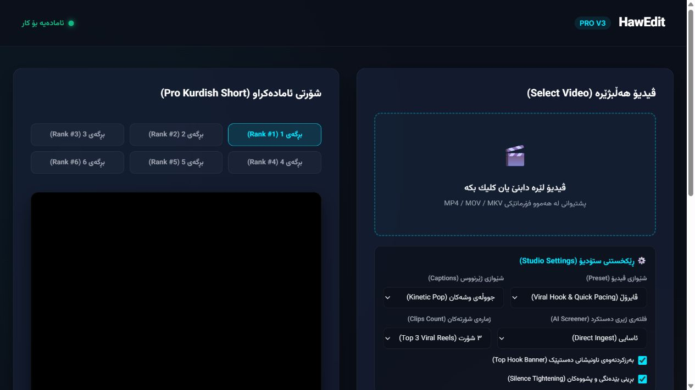
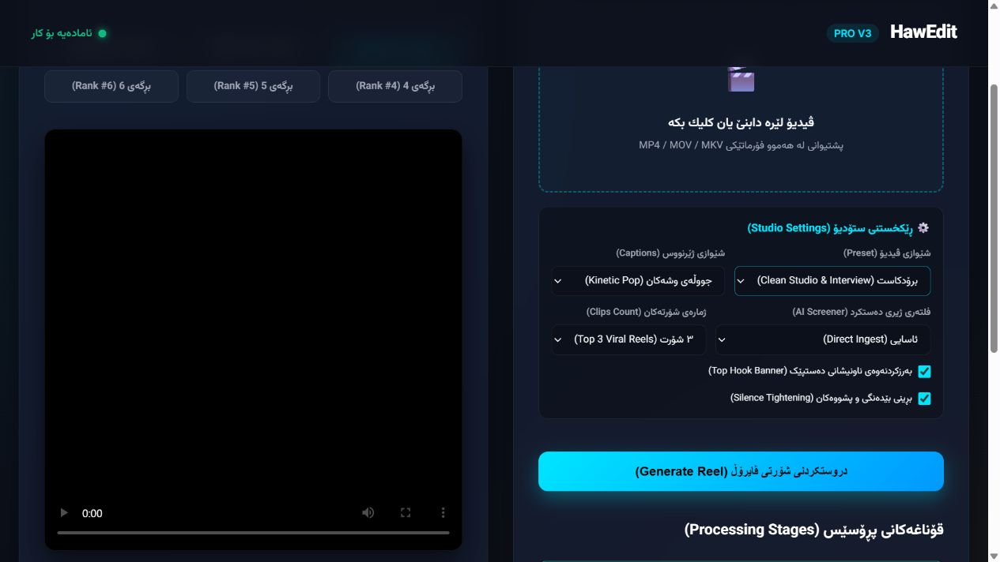
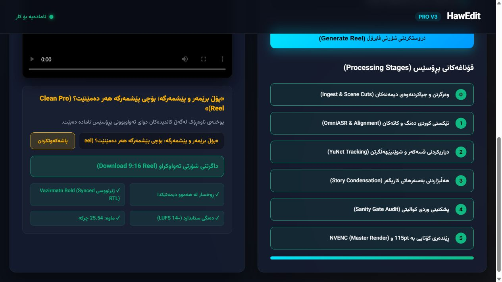
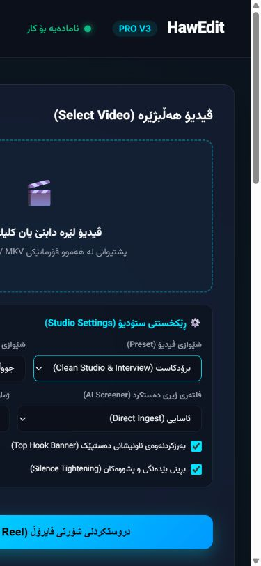

# HawEdit Dashboard Design Audit

Date: 2026-10-02 (Asia/Baghdad)
Source commit: `372a16645d7a8558bc6cedcff34a9fbfa13f712f`
Scope: existing local dashboard, first visit, settings, idle processing display,
preview/export affordances, and phone reflow. Target inferred from this workspace;
the scope question received no answer during the audit.
Tools: Product Design audit skill, PowerShell, Codex in-app browser (CUA).
Local capture URL: `http://127.0.0.1:8080/`.
Desktop viewport: 1280 x 720; phone viewport: 390 x 844.
These are browser viewport observations on this Windows host, not real-device results.

## Verdict

The Kurdish-first identity and labeled native settings provide a useful starting
point. Mobile clipping prevents access to important controls, while the first visit
mixes an empty source picker with apparently finished output and green stages.
The interface needs usable input and an unambiguous job state before visual polish.
This is a bounded dashboard audit, not an end-to-end processing certification.

## Steps And Evidence

1. **Open dashboard - needs improvement.** The source picker is empty, but six
   ranked clips already appear. The output is not visibly identified by source,
   job date, or whether it belongs to a prior run. The video region remains black.
   Strengths: prominent product identity, Sorani labels, RTL document direction.
   Evidence: `02-entry-viewport.jpg` and `observed-dom.txt`.

2. **Choose studio settings - partially healthy.** Selecting the broadcast preset
   updates the selected option. Native selects and checkboxes have accessible
   names. Generation is below the first desktop viewport, and technical choices
   consume substantial space before the task can start. Processing effects of
   these options were not tested. Evidence: `03-settings.jpg`.

3. **Generate without a file - blocked verification.** Generate is enabled with an
   empty source picker. Clicking it caused the capture/control API to time out;
   the original tab could not subsequently be inspected or closed through that
   API. Source inspection shows a native alert for empty input (`web.py:612`),
   but its appearance and dismissal were not captured. This does not establish a
   product hang. File selection, upload, and new processing were not completed.

4. **Inspect stages, preview, and export - needs improvement; delivery unverified.**
   All six stages are green and the progress strip appears full before a new run.
   Output also displays face coverage, subtitle sync, loudness, and duration
   checkmarks. No visible provenance connects them to this session's input or
   measurements. The preview stays black; the browser accessibility state reports
   unavailable media. Opening the advertised media URL was blocked by the browser
   (`ERR_BLOCKED_BY_CLIENT`), so media existence, playback, and download success
   remain unverified. Rank-two interaction did not produce a verified change
   after the original tab became blocked; no broken-rank-control finding is made.
   Evidence: `04-preview-export.jpg`.

5. **Use phone layout - blocking layout defect.** At a 390px viewport, document
   width is 608 CSS pixels. The upload box begins at approximately x=-201;
   captions and clip-count selects begin at x=-184. Their contents extend beyond
   the visible left edge. The column stacks, but its contents do not shrink to
   the available width. Evidence: `06-mobile-entry.jpg` and live DOM rectangles.

## Highest-Impact Findings

| Priority | Finding | Evidence | Recommended Change |
| --- | --- | --- | --- |
| P1 | Phone upload/settings extend off-screen | Step 5 | Allow grid items to shrink, constrain control width, stack settings at narrow widths, and verify RTL reflow. |
| P1 | Video picker lacks keyboard semantics | Steps 1-2, observed DOM | Use a focusable button or accessible file input with a visible label. The clickable dropzone is a DIV with no role or tabindex; its file input is display:none. |
| P1 | Current input and apparent completed results lack a visible relationship | Steps 1, 4 | Identify prior output by source/job/time; give a new session an explicit empty or idle state. Show progress and measured quality only for the selected job. |
| P2 | Unavailable preview gives little recovery guidance | Steps 1, 4 | Provide a useful poster and an inline loading/error state with recovery actions. Confirm actual playback using a supported media environment. |
| P2 | Processing updates have no status semantics | Step 4, observed DOM | Add progress semantics and a restrained live status region. The rendered page has no aria-live, role=status, or role=progressbar elements. Test announcements with assistive technology. |
| P2 | Empty-input recovery relies on a native alert | Step 3, supplemental source | Disable generation until usable input exists or show a field-level error with managed focus. Verify the actual error flow in an interactive browser. |

## Accessibility And Evidence Limits

Confirmed strengths: `lang=ckb`, `dir=rtl`, named native selects and checkboxes,
and an accessible name on the headline editor. Contrast of muted labels and green
quality text is a visible risk requiring contrast measurement, not a confirmed
WCAG failure. No screen-reader session, complete keyboard traversal, color ratio,
zoom test, real-device test, caption inspection, or completed video run was performed.

The browser-control failure after empty generation limits later click evidence.
A fresh tab allowed rendering, option selection, DOM inspection, and phone captures;
this does not prove all interactions work or fail. No customer video was uploaded,
no paid processing was started, and no caption was saved.

Capture quality: `01-dashboard.jpg` was rejected because full-page capture omitted
the input column despite a correct desktop DOM layout. It is not layout evidence.
`05-rank-two.jpg` is retained as an unsuccessful interaction capture, not accepted
proof of a rank-two state. Only the four screenshots embedded above are accepted.

## Grounding And Follow-Up

BLUEPRINT.md section 1 requires visible failure; section 2's architecture includes
human QC. This audit recommends making those distinctions visible in the dashboard;
it makes no claim about backend enforcement or editorial quality. Existing vault
notes informed context but were not used as current audit evidence.

No runtime source was edited. No repository task or feature was marked complete,
and the verification gate/CI were not run for this evidence-only audit.
Implementation requires the repository's research, impact-map, and approved-plan
workflow. Start that plan with phone reflow, the input control, and selected-job state.
